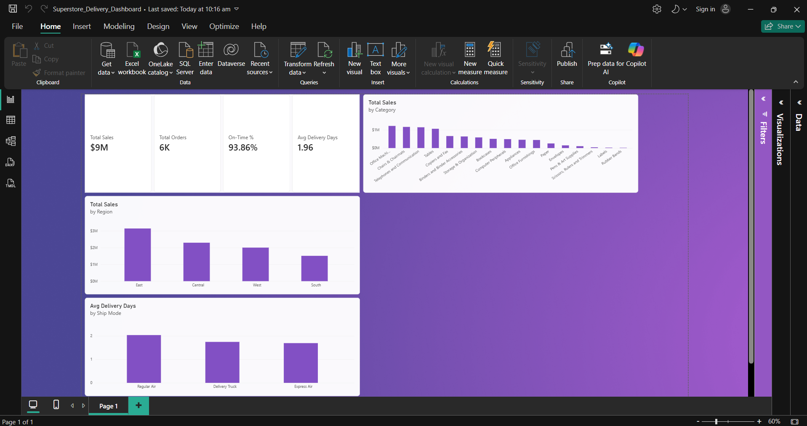

# Superstore Delivery Dashboard (Power BI)

A Power BI dashboard analyzing sales and delivery performance for a Superstore orders dataset. It answers four questions: how much did we sell, how many orders, how often were deliveries on time, and how fast were they?

## Dashboard preview

## KPIs

- **Total Sales:** $9M
- **Total Orders:** 6K (distinct orders; one order can have multiple line items)
- **On-Time Delivery:** 93.86%
- **Average Delivery Days:** 1.96

## Visuals

- KPI cards for the four metrics above.
- **Total Sales by Region** — East leads, followed by Central, West, and South.
- **Total Sales by Category** — Office Machines, Chairs & Chairmats, and Telephones and Communication lead.
- **Average Delivery Days by Ship Mode** — Regular Air is slowest (~2.1 days), Express Air fastest (~1.7 days), all within their promised windows on average.

## Data model

Source file: Superstore orders CSV (Order Date, Ship Date, Ship Mode, Region, Category, Sales, and more), from the classic Superstore dataset (fenago/tableau-fundamentals copy).

### Calculated columns

- `Delivery Days = DATEDIFF(Superstore[Order Date], Superstore[Ship Date], DAY)`
- `Expected Max Days = SWITCH(Superstore[Ship Mode], "Express Air", 2, "Regular Air", 5, "Delivery Truck", 7, BLANK())`
- `On Time? = IF(Superstore[Delivery Days] <= Superstore[Expected Max Days], "Yes", "No")`

On-time windows used: Express Air ≤ 2 days, Regular Air ≤ 5 days, Delivery Truck ≤ 7 days.

### Measures

- `Total Sales = SUM(Superstore[Sales])`
- `Total Orders = DISTINCTCOUNT(Superstore[Order ID])` — distinct orders, not order lines.
- `Avg Delivery Days = AVERAGE(Superstore[Delivery Days])`
- `Median Delivery Days = MEDIAN(Superstore[Delivery Days])` — computed alongside the average as a cross-check against outliers.
- `On-Time % = DIVIDE(COUNTROWS(FILTER(Superstore, Superstore[On Time?] = "Yes")), COUNTROWS(Superstore))`

## Data-quality note

The first build showed impossible negative delivery days (e.g., −24 days). Checking one order by hand proved it was a parsing bug, not bad source data: Power BI had read "11/12/2020" day-first (11 December) while "11/17/2020" could only be month-first, so Dec 11 → Nov 17 computed as −24 days. Fixed in Power Query with Change Type → Using Locale → Date, English (United States). After the fix, no negative delivery days remained.

## Files

- `Superstore_Delivery_Dashboard.pbix` — the Power BI file (open in Power BI Desktop).
- `dashboard.png` — screenshot of the finished dashboard.

## Tools

Power BI Desktop, DAX, Power Query.
